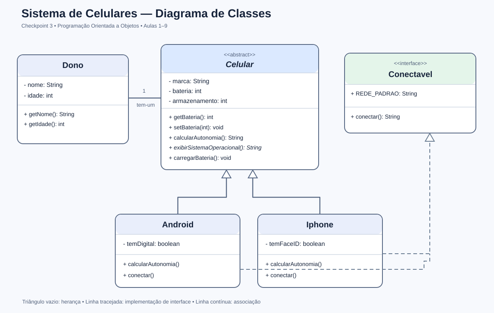
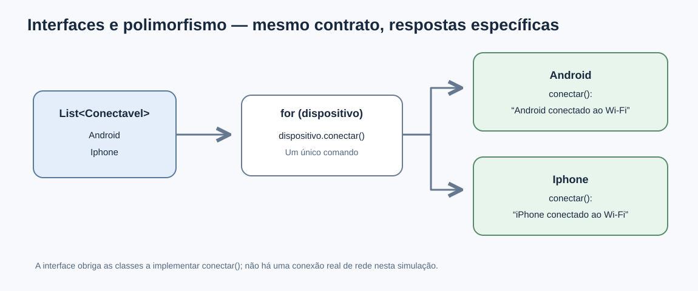
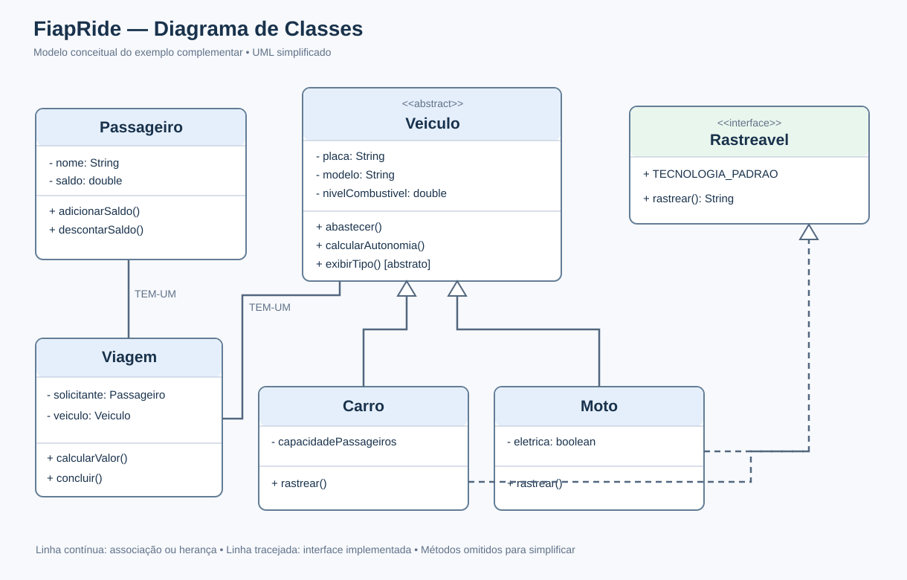

# Checkpoint 3 — Programação Orientada a Objetos

## Informações do aluno

- **Nome:** Luís Roberto Lanzoni Kihara Júnior
- **RM:** 567406
- **Turma:** CCPR
- **Curso:** Ciência da Computação — FIAP
- **GitHub:** [@luislanzonik](https://github.com/luislanzonik)

## Descrição do projeto

Este repositório contém **dois exemplos em Java**: o projeto pessoal de celulares e uma demonstração complementar **FiapRide**, desenvolvidos para aplicar os conteúdos de POO das Aulas 1 a 9. O sistema representa um proprietário e diferentes tipos de celular, incluindo Android e iPhone. Permite testar bateria, armazenamento, validação de valores, construtores, herança, sobrescrita de métodos, classes abstratas e uma interface de conexão simulada.

O exemplo FiapRide possui classes próprias para Passageiro, Veiculo, Carro, Moto, Viagem e a interface Rastreavel. Foi incluído como demonstração complementar, sem substituir o projeto pessoal. A autonomia da bateria é **fictícia e didática**, não uma medição real.

## Classes e estrutura

| Componente | Responsabilidade |
| --- | --- |
| `Dono` | Guarda nome e idade do proprietário. |
| `Celular` | Superclasse abstrata: dados encapsulados e métodos compartilhados. |
| `Android` | Subclasse que sobrescreve métodos e implementa Conectavel. |
| `Iphone` | Subclasse que sobrescreve métodos e implementa Conectavel. |
| `Conectavel` | Interface com a constante REDE_PADRAO e o método conectar(). |
| `SistemaPrincipal` | Executa os testes de todas as etapas. |

```text
src/br/com/fiapride/
  main/SistemaPrincipal.java
  model/Celular.java
  model/Android.java
  model/Iphone.java
  model/Dono.java
  model/Conectavel.java
docs/
  diagrama-classes.svg
  fluxo-interfaces.svg
```

## Diagramas





> Diagramas elaborados a partir do código. Se forem necessários prints diretamente do Astah, acrescentá-los antes de entregar.

## Checklist de implementação

- [x] Aula 1 — Classes e objetos.
- [x] Aula 2 — Métodos com parâmetros, comportamentos e validação.
- [x] Aula 3 — Encapsulamento com private, getters e setters.
- [x] Aula 4 — Construtores padrão e personalizado; this(), this. e super().
- [x] Aula 5 — Associação Celular TEM-UM Dono.
- [x] Aula 6 — Herança: Android e Iphone estendem Celular.
- [x] Aula 7 — Polimorfismo: sobrescrita de calcularAutonomia() e lista de Celular.
- [x] Aula 8 — Classe Celular abstrata e exibirSistemaOperacional() implementado nas filhas.
- [x] Aula 9 — Interface Conectavel, implements, constante e teste de conectar().


## Exemplo complementar: FiapRide

Além do sistema de celulares, o repositório contém um exemplo independente do domínio citado no enunciado:

| Aula | Demonstração FiapRide |
| --- | --- |
| 1 — Classes e objetos | Objetos de Passageiro, Carro e Moto. |
| 2 — Métodos | Passageiro.adicionarSaldo() e Veiculo.abastecer(). |
| 3 — Encapsulamento | Campos privados, getters e métodos de alteração com validação. |
| 4 — Construtores | Passageiro com construtor padrão e parametrizado; Veiculo com parâmetros obrigatórios. |
| 5 — Associação | Viagem associa Passageiro e Veiculo. |
| 6 — Herança | Carro e Moto estendem Veiculo. |
| 7 — Polimorfismo | calcularAutonomia() sobrescrito e List<Veiculo>. |
| 8 — Classe abstrata | Veiculo é abstract; exibirTipo() é abstrato. |
| 9 — Interface | Rastreavel, sua constante TECNOLOGIA_PADRAO e implementações de rastrear(). |



Para executar o exemplo no Eclipse, abra `src/br/com/fiapride/main/DemonstracaoFiapRide.java` e selecione **Run As → Java Application**. O programa usa dados fictícios e simulações didáticas: o rastreamento não se conecta a GPS real, e a tarifa de R$ 2,50 por quilômetro é ilustrativa.

## Perguntas de reflexão

> **Leia e adapte as respostas antes de entregar.** São propostas baseadas no código, não um relato verificado da sua experiência pessoal.

### Aula 1 — Classes e Objetos

**Pergunta:** Por que criar uma classe Passageiro em vez de variáveis soltas no main? Como isso ajuda com muitos usuários?

**Resposta:** Classes agrupam dados e ações de uma mesma entidade. Sem elas, seria preciso administrar inúmeras variáveis individuais, aumentando erros e repetições. Uma classe define um modelo reutilizável, a partir do qual criamos objetos independentes. Métodos e validações também ficam centralizados. Mesmo com um milhão de passageiros, não seria necessário reescrever a estrutura para cada usuário. No projeto pessoal, Celular e Dono demonstram essa organização: cada objeto guarda suas próprias informações e participa das operações do sistema.

### Aula 2 — Métodos

**Pergunta:** Por que criar adicionarSaldo(valor) em vez de alterar diretamente saldo? Quais os riscos?

**Resposta:** Um método concentra as regras necessárias para uma operação. Um adicionarSaldo(valor) poderia rejeitar valores negativos e registrar movimentações. Com acesso direto ao saldo, outros trechos do código poderiam ignorar as verificações e gerar inconsistências. Além disso, centralizar a lógica evita repetir a mesma validação. No projeto de celulares, aumentarArmazenamento() e diminuirArmazenamento() verificam a quantidade antes de alterar o valor armazenado. Essa organização torna o código mais previsível, reutilizável e fácil de manter.

### Aula 3 — Encapsulamento

**Pergunta:** Por que é seguro disponibilizar getters, mas perigoso deixar atributos públicos?

**Resposta:** Getters permitem consultar informações sem alterar diretamente os atributos internos. Já um atributo público pode ser modificado por qualquer trecho do código, mesmo com valores inadequados. No meu projeto, bateria é private e setBateria() só aceita números entre 0 e 100. O armazenamento também é protegido contra valores negativos. Dessa forma, as validações pertencem à classe responsável pelo dado. O encapsulamento protege o estado dos objetos e reduz o risco de um erro externo comprometer as regras do sistema.

### Aula 4 — Construtores

**Pergunta:** Por que não gerar getters e setters para tudo? Como restringir alterações de modelo e placa protege o FiapRide?

**Resposta:** Nem todo atributo precisa de alteração pública. O modelo de um veículo não deveria ser trocado arbitrariamente, e a mudança da placa deve obedecer a regras específicas. Criar setters indiscriminadamente pode permitir alterações que não fazem sentido no negócio. Os construtores, por sua vez, ajudam a criar objetos com dados iniciais consistentes. No projeto de celulares, usei construtores padrão e personalizados. Utilizei this() para reutilizar a inicialização de outro construtor e this. para acessar os atributos do próprio objeto. A ideia é controlar como cada instância nasce e como pode mudar depois.

### Aula 5 — Associação

**Pergunta:** Por que uma Viagem deve receber um objeto Passageiro, e não apenas a String do nome?

**Resposta:** A String contém somente um nome, mas uma viagem pode precisar consultar outras informações ou realizar operações ligadas ao passageiro. Por exemplo, o objeto permite verificar dados necessários ao pagamento; o nome sozinho não oferece isso. Uma associação mantém a relação entre entidades sem duplicar todos os atributos. No projeto pessoal, cada Celular possui uma referência a um Dono. Por meio dessa relação, consigo consultar nome e idade do proprietário. Isso representa a associação TEM-UM, mantendo as responsabilidades de cada classe separadas.

### Aula 6 — Herança

**Pergunta:** Por que Carro não pode modificar diretamente os atributos privados de Veiculo?

**Resposta:** Atributos privados só podem ser acessados diretamente pela própria classe em que foram declarados. Essa regra protege o encapsulamento, mesmo quando existe herança. Se uma classe filha pudesse alterar livremente esses dados, ignoraria possíveis validações da classe mãe. No projeto pessoal, Android e Iphone herdam de Celular, mas usam getBateria() para consultar o nível da bateria. A superclasse continua responsável por controlar seu estado interno. Assim, a herança permite reaproveitar código sem perder os limites de acesso e as regras de cada objeto.

### Aula 7 — Polimorfismo

**Pergunta:** Por que calcularAutonomia() deve existir em Veiculo, mesmo que Carro e Moto tenham implementações próprias?

**Resposta:** Quando uma variável é declarada com o tipo da superclasse, o compilador verifica os métodos disponíveis nesse tipo. Se calcularAutonomia() existisse apenas nas classes filhas, não seria possível chamá-lo diretamente por uma variável tipada como Veiculo. Declarar o método na classe mãe estabelece o contrato comum. Em tempo de execução, o Java escolhe a implementação do objeto concreto. No meu projeto, uma List<Celular> guarda Android e Iphone. O mesmo comando calcularAutonomia() executa cálculos diferentes para cada aparelho, sem precisar de if para descobrir seu tipo.

### Aula 8 — Classes Abstratas

**Pergunta:** Por que declarar Veiculo explicitamente como abstract? O que pode acontecer se esquecermos?

**Resposta:** O Java não pode deduzir sozinho se uma classe deve representar um objeto independente ou apenas servir como modelo. Essa é uma decisão de quem projeta o sistema. Sem abstract, seria possível criar um Veiculo genérico, mesmo que isso não faça sentido para as regras da aplicação. O modificador impede essa instanciação e permite definir métodos abstratos obrigatórios para as subclasses concretas. No projeto pessoal, declarei Celular como abstrata e criei exibirSistemaOperacional(). Android e Iphone são obrigados a implementar esse método. O teste new Celular(...) demonstra o erro esperado e deve permanecer comentado no código final.

### Aula 9 — Interfaces

**Pergunta:** Por que Java permite herdar de uma classe, mas implementar várias interfaces? Como isso evita conflitos?

**Resposta:** Herdar de duas classes com implementações diferentes do mesmo método poderia gerar ambiguidade sobre qual comportamento utilizar. Por isso, Java permite herança simples de classes. Interfaces oferecem contratos de comportamento que diferentes classes podem implementar, sem exigir herança múltipla de estado. Uma classe pode implementar várias interfaces e fornecer suas próprias implementações dos métodos exigidos. No meu projeto, Android e Iphone herdam de Celular e implementam Conectavel. Ambas possuem conectar(), mas cada uma produz sua própria mensagem. A interface também define a constante REDE_PADRAO, usada nos testes do main.

## Desafios técnicos implementados

**Qual domínio foi escolhido?** Sistema de gerenciamento e simulação de celulares, com Android e iPhone.

**Quais classes foram criadas?** Celular, Android, Iphone, Dono e SistemaPrincipal. Também foi criada a interface Conectavel.

**Qual foi o maior desafio técnico?**

Uma dificuldade técnica do projeto foi conciliar o encapsulamento com os recursos de herança, polimorfismo e classes abstratas. Inicialmente, atributos como bateria e armazenamento eram acessados diretamente em diferentes classes. Quando os atributos passaram a ser privados, foi necessário atualizar as classes filhas para usar getBateria() e a classe principal para utilizar os getters e setters. Outra etapa exigiu transformar Celular em abstract. Isso fez com que a criação direta de um objeto Celular deixasse de ser permitida, exigindo que o main passasse a criar um Android ou um Iphone. Na Aula 9, a interface Conectavel estabeleceu mais um contrato para as subclasses. Os testes no console ajudaram a verificar se as alterações continuavam funcionando. Esse processo demonstrou a importância de manter as responsabilidades das classes claras e testar o sistema a cada mudança.

## Conclusão

**O que aprendi nas nove aulas?**

O projeto demonstrou como representar entidades com classes e objetos, organizar operações com métodos e proteger dados por encapsulamento. Também apresentou diferentes formas de inicializar objetos com construtores e de relacioná-los por associação. A herança permitiu reutilizar comportamentos, enquanto o polimorfismo possibilitou executar o mesmo método com resultados específicos em Android e iPhone. As classes abstratas impediram a criação de uma instância genérica de Celular e definiram operações obrigatórias para suas filhas. Por fim, a interface Conectavel mostrou como estabelecer um contrato de comportamento que pode ser implementado por diferentes classes.

**Qual conceito foi mais difícil de entender?**

*Resposta-modelo a confirmar pessoalmente:* A relação entre herança, polimorfismo e classes abstratas exige mais atenção, porque é necessário distinguir o tipo da variável do tipo real do objeto. O exemplo List<Celular> ajudou a mostrar como o mesmo método executa implementações diferentes. A implementação e os testes no console tornaram esse comportamento mais concreto.

**O que melhoraria no projeto se pudesse refazer?**

Poderia separar os testes em classes específicas, adicionar testes automatizados e refinar a validação de dados. Também seria interessante representar melhor a capacidade total do armazenamento e calcular a autonomia a partir de características reais dos aparelhos, em vez de valores fictícios. Outra melhoria seria padronizar nomes e comentários do código, além de tratar explicitamente entradas inválidas com mensagens ao usuário.

## Verificação automática da compilação\n\nO workflow [Verificar compilacao Java](.github/workflows/verificar-java.yml) compila todos os arquivos com Java 21 e executa as duas classes principais a cada push. Consulte a [aba Actions](https://github.com/luislanzonik/fiap-poo/actions) para saber se a execução ficou verde. Os diagramas em SVG são arquivos de imagem; não são capturas do Astah.\n\n## Como executar

1. Abra o projeto Java no Eclipse.
2. Localize `src/br/com/fiapride/main/SistemaPrincipal.java`.
3. Execute com **Run As → Java Application**.
4. Confira as seções do console referentes a encapsulamento, construtores, polimorfismo, classes abstratas e interfaces.

## Revisão antes da entrega

- [x] Informar turma acadêmica (CCPR).\n- [ ] Revisar as reflexões pessoais em primeira pessoa.
- [x] Incluir demonstração FiapRide complementar ao projeto pessoal.
- [ ] Nome: o PDF menciona `poo-[seu-nome]` na abertura e `poo-fiapride-[seu-nome]` na entrega. Preferir o padrão específico da entrega, após confirmação do professor.
- [x] Diagramas de classes e interfaces incluídos como SVG no diretório `docs/` (o enunciado exige imagens, mas não especifica Astah).
- [x] Manter o histórico de commits e o repositório público.
